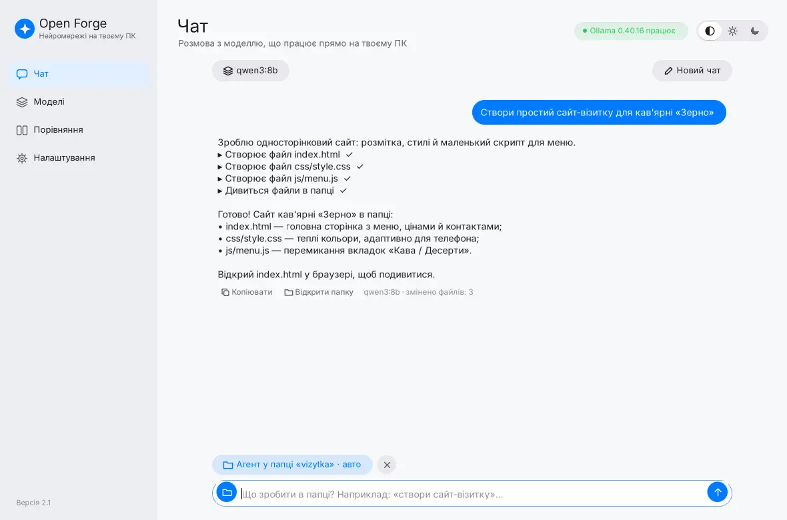
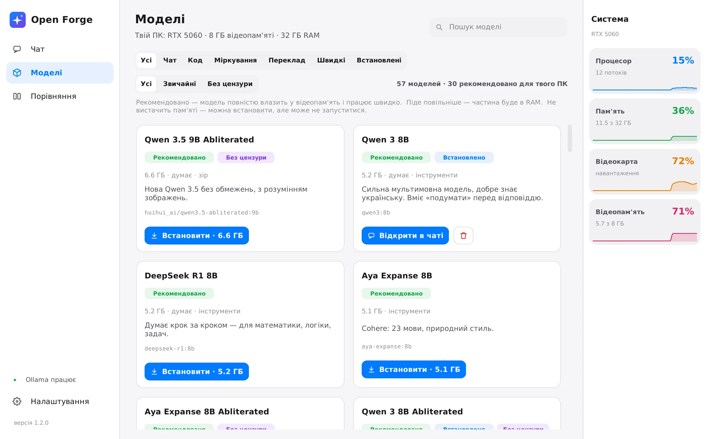
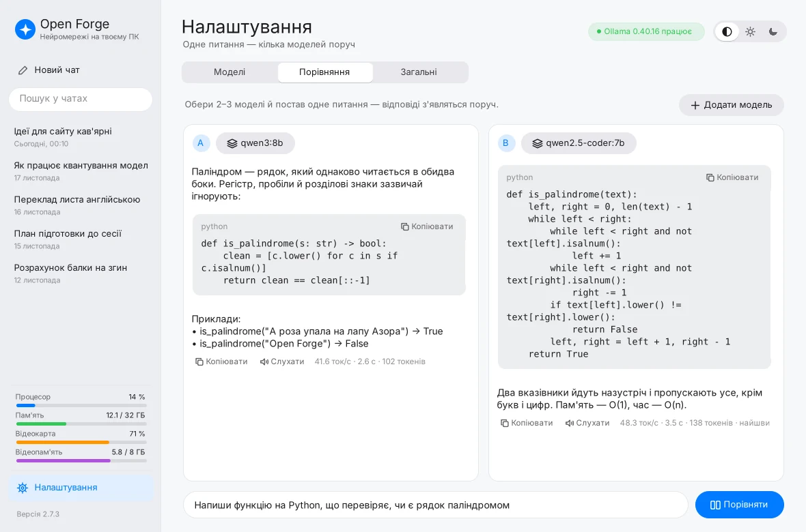
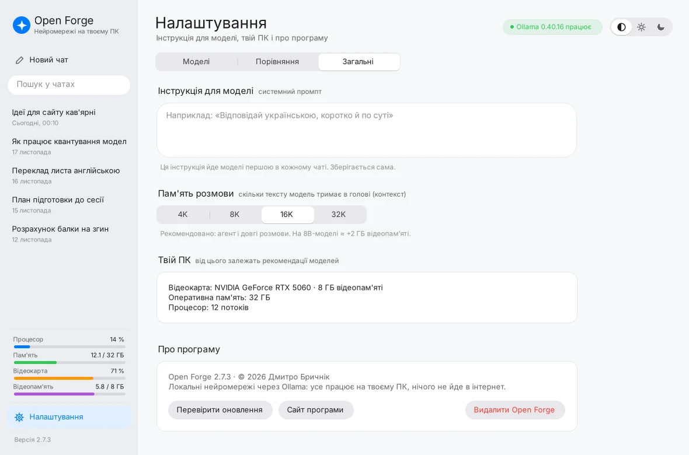

# Open Forge

**Нейромережі прямо на твоєму ПК.** 
Чат, агент, що сам пише й тестує проєкти, порівняння моделей і каталог з 134 моделей — 
у звичайному Windows-застосунку поверх [Ollama](https://ollama.com). Без хмари, без підписок, без інтернету після завантаження моделі.

### [⬇️ Завантажити останню версію](https://github.com/Dimonchikk/Open-Forge/releases/latest) · [Можливості](#можливості) · [Як зібрати](#як-зібрати) · [Сайт](https://dimonchikk.github.io/Open-Forge/) · [Що нового](CHANGES.md)

<picture>
  <source media="(prefers-color-scheme: dark)" srcset="https://raw.githubusercontent.com/Dimonchikk/Open-Forge/main/docs/img/agent_dark.webp">
  
</picture>

Агент сам створює сайт, фотографує результат і показує кроки, файли й модель у бічній панелі

## Як це виглядає

<table>
<tr>
<td width="50%" valign="top">

<picture>
  <source media="(prefers-color-scheme: dark)" srcset="https://raw.githubusercontent.com/Dimonchikk/Open-Forge/main/docs/img/chat_dark.webp">
  
</picture>

**Чат** 
Думки моделі, код з кнопкою «Копіювати», швидкість у токенах і озвучка відповіді

</td>
<td width="50%" valign="top">

<picture>
  <source media="(prefers-color-scheme: dark)" srcset="https://raw.githubusercontent.com/Dimonchikk/Open-Forge/main/docs/img/models_dark.webp">
  
</picture>

**Каталог моделей** 
134 моделі: сила 1–10, позначка, чи потягне твій ПК, фільтри й розділ Hugging Face

</td>
</tr>
<tr>
<td width="50%" valign="top">

<picture>
  <source media="(prefers-color-scheme: dark)" srcset="https://raw.githubusercontent.com/Dimonchikk/Open-Forge/main/docs/img/compare_dark.webp">
  
</picture>

**Порівняння** 
Одне питання — до трьох моделей поруч, зі швидкістю кожної

</td>
<td width="50%" valign="top">

<picture>
  <source media="(prefers-color-scheme: dark)" srcset="https://raw.githubusercontent.com/Dimonchikk/Open-Forge/main/docs/img/settings_dark.webp">
  
</picture>

**Налаштування** 
Інструкція для моделі, пам'ять розмови, твій ПК і оновлення

</td>
</tr>
</table>

Знімки самі перемикаються між світлою й темною темою разом з темою GitHub.

## Можливості

### 💬 Розмова
- Чат зі стрімінгом, таблицями, кодом і «Думками моделі» — перемикач «Думати» для моделей, що вміють міркувати
- Повідомлення можна редагувати, видаляти й перегенерувати, відповіді — слухати вголос
- Фото, скріншоти й файли: PDF, Word, текст і код (кнопка, Ctrl+V або перетягування)
- Історія чатів з пошуком; чернетка й папка агента — окремі для кожного чату

### 🤖 Агент
- Працює в обраній папці: створює файли, запускає команди й програми
- Сам натискає кнопки у вікнах програм і фотографує кожен крок — тестує, як людина
- Не здає «зразок»: помічає заглушки замість коду й перевіряє, що проєкт запускається
- Бічна панель «Прогрес» як у Claude: кроки, створені файли, скріншоти, модель і пам'ять розмови
- Три рівні дозволів: «Питати завжди», «Авто» (файли сам, команди й видалення — з твого дозволу) і «Повний доступ»

### 📦 Моделі
- Каталог із 134 моделей: чат, код, зображення, міркування, переклад, швидкі — звичайні й без цензури
- Сила 1–10, потрібна пам'ять і позначка, чи потягне твій ПК
- Завантаження й видалення в один клік; розділ «Hugging Face» для моделей, яких немає в Ollama
- Порівняння до трьох моделей поруч

### 🖥 ПК і пристрої
- Кнопка Ollama: запустити, перезапустити або зупинити прямо з програми
- Навантаження процесора, пам'яті й відеокарти в боковому меню
- Пристрої: Android, iPhone, плати ESP32, Arduino, Raspberry Pi Pico, STM32 — з режимом і COM-портом
- Світла й темна тема, як у Windows

## Швидкий старт

1. Встанови [Ollama](https://ollama.com/download).
2. Завантаж `OpenForge-setup.exe` з [останнього релізу](https://github.com/Dimonchikk/Open-Forge/releases/latest) і запусти — права адміністратора не потрібні.
3. У розділі «Моделі» обери модель з зеленою позначкою (вона швидко працюватиме на твоєму ПК) і натисни «Завантажити».
4. Пиши в чат. Щоб модель сама робила проєкт, натисни кнопку з папкою біля поля вводу й обери папку.

**Вимоги:** Windows 10 або 11, Ollama. Для моделей 7–9B вистачить 16 ГБ оперативної пам'яті; відеокарта з 8 ГБ і більше робить їх у рази швидшими.

## Як зібрати

Код — C# 5 / .NET Framework 4 / WinForms, без сторонніх бібліотек.

- Локально на Windows: подвійний клік по `src/build.bat` — з'являться `src/OpenForge.exe` і `src/OpenForge-setup.exe`.
- На GitHub: Actions → «Збирання» → «Run workflow». З номером версії створюється чернетка релізу з `CHANGES.md`.

Інсталятор — це та сама програма під назвою з `setup`: ставить себе в `%LOCALAPPDATA%\Programs\OpenForge` без прав адміністратора.

Остання версія на Python — у гілці `python-legacy`.

## Ліцензія

[MIT](LICENSE)
