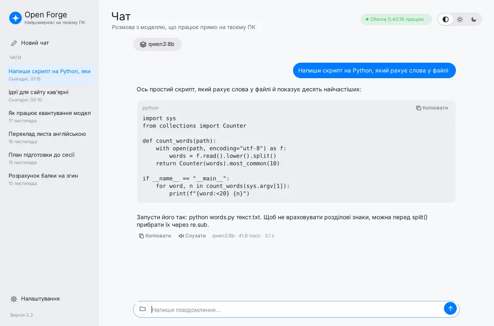

# Open Forge

**Нейромережі прямо на твоєму ПК.** 
Чат, агент, що сам пише й тестує проєкти, порівняння моделей і каталог з 134 моделей — 
у звичайному Windows-застосунку поверх [Ollama](https://ollama.com). Без хмари, без підписок, без інтернету після завантаження моделі.

### [⬇️ Завантажити останню версію](https://github.com/Dimonchikk/Open-Forge/releases/latest) · [Можливості](#можливості) · [Як зібрати](#як-зібрати) · [Сайт](https://dimonchikk.github.io/Open-Forge/) · [Що нового](CHANGES.md)

<picture>
  <source media="(prefers-color-scheme: dark)" srcset="https://raw.githubusercontent.com/Dimonchikk/Open-Forge/main/docs/img/chat_dark.webp">
  
</picture>

## Можливості

- 💬 **Чат** зі стрімінгом, таблицями, кодом і «Думками моделі». Повідомлення можна редагувати, видаляти й перегенерувати, а відповіді — слухати вголос
- 🖼 **Фото, скріншоти й файли**: PDF, Word, текст і код (кнопка, Ctrl+V або перетягування)
- 🤖 **Агент у папці**: модель сама створює файли, запускає команди й програми, натискає кнопки у вікнах і фотографує кожен крок. Перевіряє, що проєкт повний і запускається, а не здає «зразок»
- 📋 **Бічна панель «Прогрес»** як у Claude: кроки, створені файли, скріншоти, модель і пам'ять розмови
- ⚖️ **Порівняння** до трьох моделей поруч
- 📦 **Каталог із 134 моделей**: чат, код, зображення, міркування, переклад, швидкі — звичайні й без цензури. Сила 1–10 і позначка, чи потягне твій ПК
- 🤗 **Hugging Face**: моделі, які Ollama не завантажує сама, Open Forge качає й додає в Ollama сам (з докачуванням)
- 🔌 **Пристрої**: телефони Android і iPhone, плати ESP32, Arduino, Raspberry Pi Pico, STM32 — з режимом і COM-портом
- ⏻ **Кнопка Ollama**: запустити, перезапустити або зупинити Ollama прямо з програми
- 🗂 **Історія чатів** з пошуком; чернетка й папка агента — окремі для кожного чату
- 🎨 Світла й темна тема, як у Windows

## Як зібрати

Код — C# 5 / .NET Framework 4 / WinForms, без сторонніх бібліотек.

- Локально на Windows: подвійний клік по `src/build.bat` — з'являться `src/OpenForge.exe` і `src/OpenForge-setup.exe`.
- На GitHub: Actions → «Збирання» → «Run workflow». З номером версії створюється чернетка релізу з `CHANGES.md`.

Інсталятор — це та сама програма під назвою з `setup`: ставить себе в `%LOCALAPPDATA%\Programs\OpenForge` без прав адміністратора.

Остання версія на Python — у гілці `python-legacy`.

## Ліцензія

[MIT](LICENSE)
